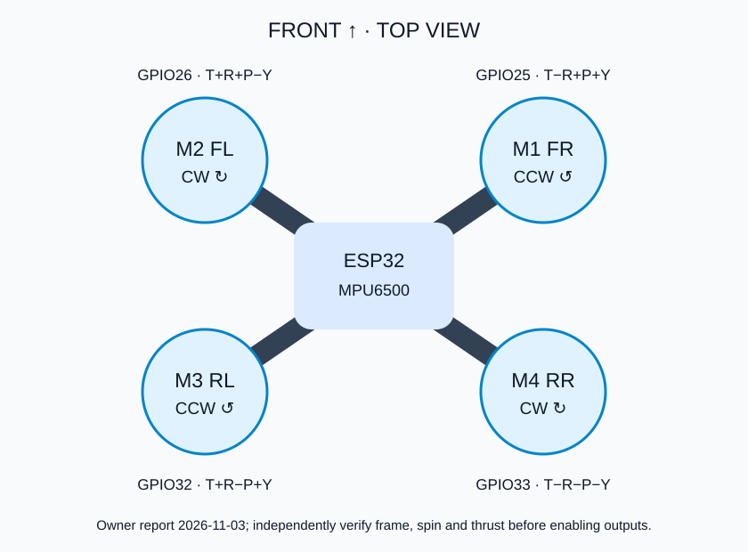

# Gesture Controlled Drone

Two ESP32 boards implement a calibrated gesture transmitter and an experimental onboard quadcopter controller. **Not flight-ready. All ESC output verification gates default to false.** Software tests cannot establish hardware or flight safety.

The existing PlatformIO architecture was extended rather than migrated. [Repository](https://github.com/diyan07-ctrl/esp32-gesture-controlled-drone) · [CI](https://github.com/diyan07-ctrl/esp32-gesture-controlled-drone/actions/workflows/firmware-ci.yml)

## Hardware

| Subsystem | Owner-specified hardware |
|---|---|
| Drone | F450 with PDB; ESP32 DevKit V1 / ESP32-D0WDQ6, 4 MB flash |
| Propulsion | Four A2212 1000 KV motors, four 30 A ESCs, 1045 propellers |
| Battery | 3S 11.1 V 2200 mAh 50C LiPo; ratings are owner reports, not load validation |
| Drone sensors | MPU6500; HC-SR04 supplementary ultrasonic range |
| Glove | ESP32, MPU6500, two resistive flex sensors |

Motor numbering was confirmed by the owner on 2026-11-03: viewed from above, M1 front-right, then M2 front-left, M3 rear-left, M4 rear-right counterclockwise. M1/M3 spin CCW; M2/M4 CW. Signals are GPIO25/26/32/33 respectively. Independently verify these against the frame, including thrust/prop direction, before enabling outputs.

Both IMUs use SDA21/SCL22, provisional I2C address 0x68. Glove flex ADC1 inputs are GPIO34/35. HC-SR04 Trigger16/Echo17 are **proposed, not confirmed wiring**; acquisition defaults disabled. Its 5 V Echo requires a divider or level shifter before the ESP32. Battery ADC34 is optional and disabled until a verified divider is installed. See [full wiring](docs/connection-tables.md).

Share ESC signal grounds with ESP32 ground. Never parallel ESC BEC positives. Supply the drone ESP32 through an appropriate regulated input, never directly from 3S. The electronics supply, ESC models/protocols, divider, sensor breakout circuits and loaded propulsion performance still need validation.

## Software structure

~~~text
firmware/
  common/                 shared protocol, configuration, IMU, flex, gesture,
                          estimator, PID, mixer, ESC, range, safety, ESP-NOW
  glove/src/              transmitter and measured NVS flex calibration
  drone/src/              250 Hz control task and supplementary range acquisition
  motor_test/src/         separate propeller-off, explicitly commanded test image
tests/unit/               shared logic, sensor/gesture/PWM and Python utility tests
tests/integration/        mocked packet → supervisor → PWM tests
simulation/tests/         assumed single-axis and three-axis plants
tools/                    test runner, pairing provisioning, diagnostics utilities
docs/ hardware/ diagrams/ wiring, test records, architecture, diagrams and BOM
~~~

One configuration header and one protocol header define firmware behavior. ESP-NOW uses fixed-peer encrypted unicast, application acknowledgments, sessions, sequence checking, CRC and explicit encoding. Command v2 contains flex readings, gesture, orientation, normalized demands, arm and stop flags. Both boards must run v2. [Protocol](docs/communication-protocol.md) · [architecture](docs/system-architecture.md).

The glove measures endpoints rather than assuming flex ADC thresholds. Tilt controls roll/pitch, wrist angular rate controls yaw, and distinct bend combinations control throttle, arm, disarm and emergency stop. Neutral holds the existing throttle command; it does not hold altitude. See [mapping](docs/gesture-control.md) and [calibration](docs/calibration-guide.md).

The drone applies complementary attitude estimation, outer angle control, inner rate PID and configurable Quad-X mixing with desaturation. Yaw is rate-controlled; gyro integration drifts. Gains are bench starting values. HC-SR04 is supplementary telemetry, with no altitude-hold claim. [Control/tuning](docs/flight-control-algorithm.md).

## Build, flash and test

~~~sh
python -m pip install platformio==6.1.18
pio run -e glove -e drone -e motor_test
python tools/run_host_tests.py
node tools/check_repository.mjs
~~~

The platform is pinned to Espressif32 6.9.0 / Arduino ESP32 2.0.17. Wire, WiFi and Preferences are framework libraries; no external IMU/PID package is required. Windows native tests can use the pinned Zig 0.13.0 compiler with the runner's --zig option. [Detailed commands](docs/build-and-upload.md).

The owner previously detected the drone on COM9 with 4 MB flash. With propellers removed and propulsion disconnected, re-identify the port before upload:

~~~sh
pio run -e drone -t upload --upload-port COM9
pio device monitor -p COM9 -b 115200
~~~

Do not flash the glove to the drone port. Neither uploads nor physical tests have been performed during this implementation. Obtain both station MACs and use [private pairing provisioning](docs/communication-protocol.md); default builds intentionally cannot communicate or drive motors.

## Safety and validation

Startup is disarmed; arming requires valid calibrated sensors, link, timing, initialized output hardware, zero throttle, an observed arm release, and an explicit hold. Emergency, sensor faults, or command age above 200 ms shut off motor pulses and latch a fault. Reconnection never re-arms. **This immediate-cut bench failsafe can cause an airborne crash; controlled landing is not implemented.** [State machine/policy](docs/safety-and-failsafe.md) · [ESC enablement](docs/output-enablement.md).

Actual executed checks and limitations are recorded in [validation results](docs/validation-results.md). Hardware tests are **NOT EXECUTED** in this session; the owner's previous ESP32/motor checks are historical observations. Follow the ordered [propeller-off hardware procedure](docs/testing-and-validation.md). Measured power integrity, ESC shutdown behavior, IMU signs/calibration, motor direction, timing, tuned control and supervised controlled tests remain separate flight acceptance gates.

[Phase audit and execution record](docs/execution-record.md) · [Known limitations](docs/known-limitations.md) · [License](LICENSE)
