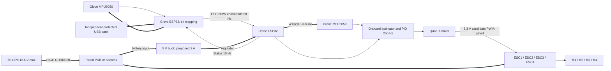
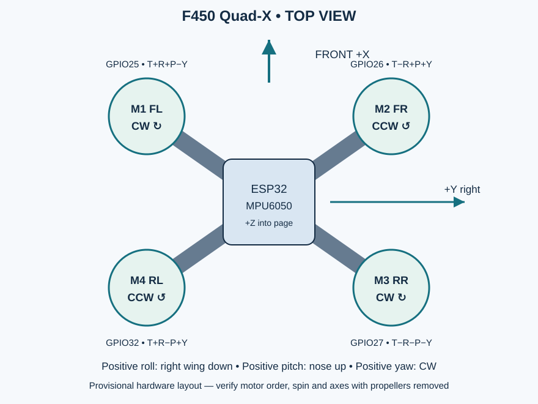
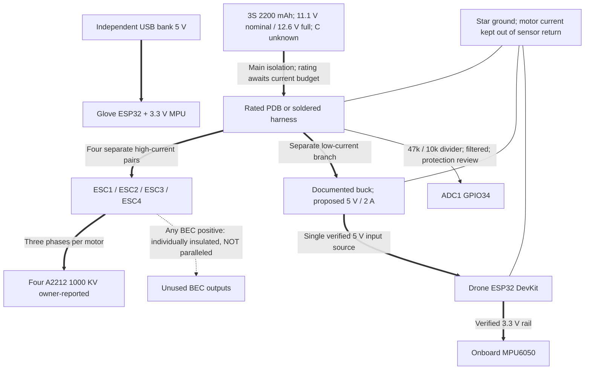
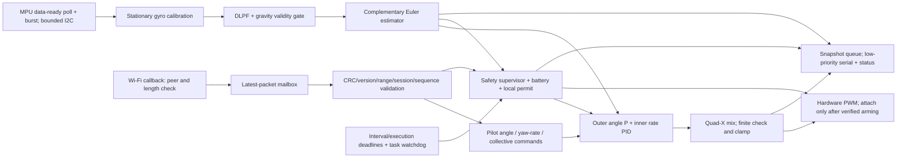

# Gesture-Controlled Drone Using ESP32

[Public GitHub repository](https://github.com/diyan07-ctrl/esp32-gesture-controlled-drone) · [Build and test runs](https://github.com/diyan07-ctrl/esp32-gesture-controlled-drone/actions/workflows/firmware-ci.yml)

**Experimental custom UAV controller. Successful compilation or bench testing does not establish flight safety. Default firmware inhibits every ESC output. This project is not flight-ready.**

A wearable ESP32-WROOM-32 and MPU6050 generate pilot commands over ESP-NOW. A second ESP32-WROOM-32 independently reads its onboard MPU6050, estimates attitude, runs stabilization, performs Quad-X mixing and controls four ESCs. **There is no dedicated flight controller, commercial fallback controller, or processor substitution.**

The project makes the complete sensing, communication, control and electrical design available for engineering study. Current deliverables are a provisional hardware design and unvalidated firmware baseline. Publication and actual test status are reported explicitly below.

## Hardware and compatibility

| Existing component | Quantity | Evidence/status |
|---|---:|---|
| F450 frame | 1 | Orientation, mass, mount and PDB rating need inspection |
| ESP32-WROOM-32 DevKit | 2 | Exact PCB variants and power-input circuits unknown |
| MPU6050 breakout | 2 | Supply/pullups/axis alignment need verification |
| A2212 motor | 4 | **1000 KV owner-reported**; manufacturer and load ratings unknown |
| Nominal 30 A ESC | 4 | Model, 3S support, BEC, pinout, signal timing and logic level unknown |
| 3S 2200 mAh LiPo | 1 | 24.42 Wh nominal; **continuous C-rating unknown** |
| Propellers | Unspecified | Motor-specific diameter/pitch/hub selection blocked |

**Whole-aircraft compatibility cannot be verified.** Required additions include a verified PDB/harness, regulated electronics supply, rated power connections, sensor/ADC conditioning, independent throttle/yaw controls, explicit switches, glove power and secure insulated mounting. Inspect integrated parts first to avoid duplicate purchases.

Read the [hardware audit](docs/hardware-feasibility-audit.md), [motor/prop selection](docs/motor-and-propeller-selection.md), [BOM table](docs/bill-of-materials.md), [BOM CSV](hardware/bom.csv), and dated [Robu.in/FlyRobo availability check](docs/supplier-availability.md). Stock is not compatibility approval.

## Architecture



Glove packets carry collective throttle, roll/pitch angle demand, yaw-rate demand and enable/arm requests. The glove does not command four motor speeds. Drone stabilization runs locally at a **target** 250 Hz, independently of the **target** 50 Hz command stream. Neither rate has been measured on owned hardware.

## Provisional wiring summary

**GPIO numbers are not physical header positions. Do not assemble until the actual board and ESC connector pinouts are verified.** Complete pin-by-pin power, signal, ground and unused-pin tables are in [connection tables](docs/connection-tables.md); machine-readable [GPIO CSV](hardware/pin-mapping.csv) is also supplied.

| Signal | Glove GPIO | Drone GPIO | Connection requirement |
|---|---:|---:|---|
| MPU SDA / SCL | 21 / 22 | 21 / 22 | Pullups to 3.3 V; verify breakout supply circuit |
| Arm switch | 18 | — | Active low to GND; explicit release before arm |
| Hold-to-enable / local run permit | 19 | 19 | Low permits; open inhibits |
| Throttle / yaw ADC | 34 / 35 | — | Separate 0–2.5 V physical controls, filtering and pulldowns |
| Battery ADC1 | — | 34 | 47k upper/10k lower, filter, protection review |
| ESC1 / ESC2 / ESC3 / ESC4 | — | 25 / 26 / 27 / 32 | 3.3 V candidate PWM; verify ESC threshold/protocol |
| Optional status LED | 23 | 23 | Series 1k resistor to LED/GND |

Sensor AD0 is tied low for address 0x68; INT is unused. Exact signal connector wire colors/order are **not assumed**. All ESC BEC positives, if present, are individually isolated. ESC signal grounds share the electronics reference, while motor return currents follow separate distribution paths.

## Motor layout and coordinate convention



| Motor | Position | Spin viewed from above | GPIO | Mixer |
|---|---|---|---:|---|
| M1 | Front-left | CW | 25 | T+R+P−Y |
| M2 | Front-right | CCW | 26 | T−R+P+Y |
| M3 | Rear-right | CW | 27 | T−R−P−Y |
| M4 | Rear-left | CCW | 32 | T+R−P+Y |

FRD axes: X forward, Y right, Z down. Positive roll lowers the right wing; positive pitch raises the nose; positive yaw is clockwise from above. Sensor raw X forward, Y left, Z up; code applies the documented transform. Verify sensor signs, motor order, rotation and thrust direction independently with props removed. [Motor mapping CSV](hardware/motor-mapping.csv).

## Power distribution



A dedicated regulated 5 V supply is proposed for the drone DevKit; its actual input must be verified. **Never connect 3S directly to the ESP32 3V3/5V inputs.** Never parallel unidentified BECs or run motor current through a breadboard or signal jumpers. Use one board power source at a time unless its schematic documents safe isolation.

At 12.6 V the proposed 47k/10k divider yields 2.211 V nominal (2.247 V worst-high at 1% tolerance). ADC protection, unpowered-input behavior, filtering and DMM calibration remain required. [Electrical design](docs/electrical-design.md), [power calculations](docs/power-budget.md), [battery analysis](docs/battery-analysis.md).

Capacity=2.2 Ah; energy=11.1×2.2=24.42 Wh; label discharge capability=2.2×C amperes. C is unknown. Flight time requires measured aircraft mass and motor thrust/current data; no measured endurance is claimed.

## Firmware architecture and control

Separate applications live in firmware/glove/src and firmware/drone/src. Shared modules provide the MPU driver, gyro calibration, complementary attitude estimator, gesture mapping, PID, mixer, protocol, radio transport, ESC candidate and safety state machine.



Roll/pitch angle targets feed a proportional outer loop, then body-rate PIDs. Yaw uses rate control without compass heading hold. Collective throttle is not altitude control. PID gains are unvalidated bench starting values. Outputs are finite-checked and clipped; clipping loses control authority and is not an optimal allocator.

ESP-NOW uses encrypted fixed-peer unicast, versioned explicit little-endian 24-byte commands, sequence/session checks, range/CRC validation and status acknowledgments. Wi-Fi callbacks only fill a mailbox. Default pairing is unconfigured; private local keys must never enter Git. [Algorithm](docs/flight-control-algorithm.md), [gesture mapping](docs/gesture-control.md), [protocol](docs/communication-protocol.md), [telemetry](docs/telemetry.md).

## Install, compile, upload and tests

Install Python 3.12 and PlatformIO Core 6.1.18:
```sh
python -m pip install platformio==6.1.18
pio run -e glove
pio run -e drone
node tools/check_repository.mjs
python -m unittest discover -s tests/unit -p test_tools.py -v
```

Root platformio.ini defines separate glove/drone targets using espressif32@6.9.0, generic esp32dev and Arduino ESP32 2.0.17. The in-tree IMU driver has no external library dependency. Confirm the actual board before upload.

Props removed, ESC power disconnected, correct board/port selected:
```sh
pio run -e glove -t upload --upload-port COM5
pio run -e drone -t upload --upload-port COM6
pio device monitor -p COM6 -b 115200
```
Ports are examples. [Complete build/upload and host-test commands](docs/build-and-upload.md). The CI workflow compiles both applications and runs shared C++, utility and static checks when GitHub Actions executes; workflow presence is not a pass.

## Calibration and bench operation

1. Verify exact components, wiring, polarity, supply rails and sensor logic levels without propulsion power.
2. Check both IMU identities/configuration independently; verify axis signs and complete stationary gyro calibration.
3. Calibrate accelerometer scale/offset and battery sensing with instruments; six-face correction is not yet implemented.
4. Provision private ESP-NOW peers; test neutral, throttle-zero, arm-release and reconnect behavior with outputs inhibited.
5. Follow the staged test plan before any ESC operation. Scope outputs disconnected from ESC first; then use verified equipment and props removed.
6. Keep every output verification gate closed until its evidence is reviewed.

[Assembly](docs/assembly-guide.md), [calibration](docs/calibration-guide.md), [validation plan](docs/testing-and-validation.md), [test record](docs/test-record-template.md), [troubleshooting](docs/troubleshooting.md).

## Safety and failsafe

BOOT → SENSOR_INITIALIZATION → CALIBRATION → DISARMED → ARMING_CHECKS → ARMED. FAULT and FAILSAFE latch. Arming needs healthy calibrated sensors, fresh validated commands, low throttle, explicit switches, acceptable voltage and verified hardware/controller flags. No auto-arm on startup or reconnection.

The **current bench-only failsafe inhibits PWM** after stale commands (>200 ms), enable loss or emergency input; sensor, battery and timing failures also inhibit outputs. Motor cutoff is dangerous airborne. No altitude sensor, automatic landing, independent hardware kill gate or redundant flight controller exists. A hung PWM peripheral can retain output until watchdog reset. **A validated airborne loss-of-link policy is an unresolved flight blocker.**

Read [safety state machine](docs/safety-and-failsafe.md) and [output enablement gate](docs/output-enablement.md). Use suitable supervision, battery handling, exclusion areas and current applicable aviation/site rules before any eventual controlled flight assessment.

## Implementation and evidence status

| Deliverable | Status |
|---|---|
| Hardware audit, electrical tables, BOM and six diagrams | Provisional; exact hardware verification pending |
| Glove/drone firmware and shared control logic | Implemented as unvalidated development baseline |
| ESC outputs | Disabled by four compile-time verification gates |
| Unit tests and CI | Passed in GitHub Actions: both firmware targets, 1,537 C++ assertions, 4 Python tests, static checks and toy simulation |
| Firmware compilation | Glove and drone compile in the pinned CI toolchain; see validation record |
| Hardware, RF, bench, HIL, flight | Not tested; toy simulation is numeric regression only |
| Public GitHub publication | Published under diyan07-ctrl; source paths/hashes and anonymous access verified |
| Flight readiness | **Not established** |

[Actual validation record](docs/validation-results.md) is authoritative. [Known limitations](docs/known-limitations.md) covers estimator dynamics, yaw drift, ADC/control faults, security/replay limits, actuator delay and missing measurements.

## Roadmap and participation

[Eight engineering milestones](docs/roadmap.md) progress from exact hardware verification to a documented controlled flight-readiness review, without automatic approval. Next blockers are ESC/model details, battery C-rating, board pinouts, aircraft mass, motor/prop curves, final power parts, compilation, physical timing tests, gain tuning and airborne failsafe design.

Read [contribution guidance](CONTRIBUTING.md), [code of conduct](CODE_OF_CONDUCT.md) and [security policy](SECURITY.md). Submit evidence-backed changes and preserve the onboard ESP32/no-dedicated-controller architecture. Code and documentation use the [MIT license](LICENSE); dependencies retain their own licenses.

[Project overview](docs/project-overview.md) · [Architecture](docs/system-architecture.md) · [Diagrams](diagrams/README.md) · [Simulation scope](simulation/README.md) · [Changelog](CHANGELOG.md) · [Publication status](docs/publication.md).
