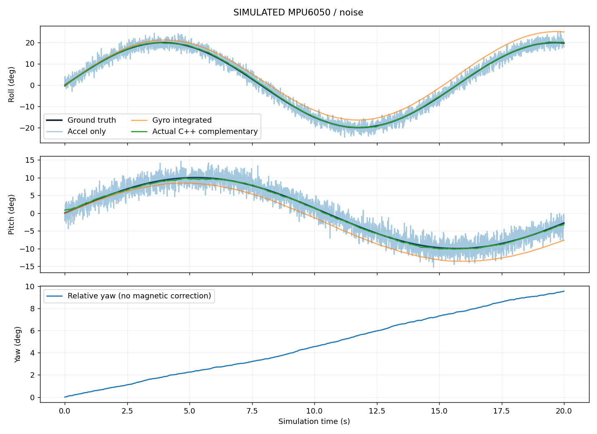
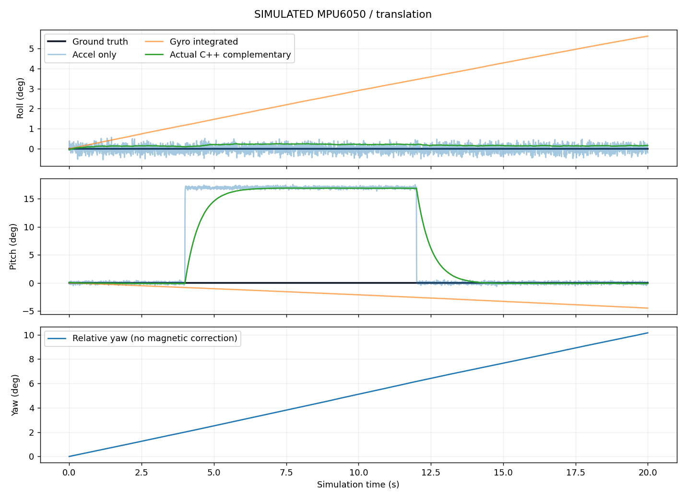
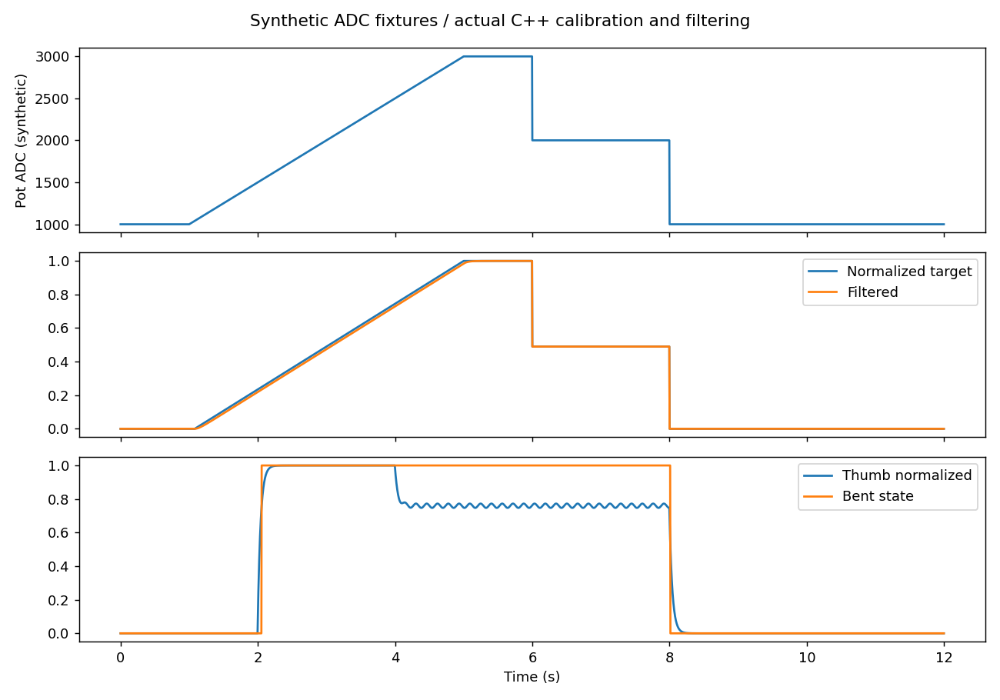

# Deterministic F450 SIL engineering report

**ALL DATA SIMULATED. No hardware or flight validation.**

Result: QUALIFIED: software regressions pass; engineering limitations remain
Revision: `673eaf6318e6270986582f455044876d98ce4f4d`; dirty source at generation: True.
Native source fingerprint: `d7c6c78085db72ede8c46385d9d06b7025093c2be8a3392ef276c99e2e30fa1a`.

## Environment and model

Harness source fingerprint: `7170dda2ac052791af8b7419b3dc8ae5462f6af933b128d448f3ae5b52b6d046`.
Python: 3.11.9 (tags/v3.11.9:de54cf5, Apr  2 2024, 10:12:12) [MSC v.1938 64 bit (AMD64)]; NumPy 2.2.6; Matplotlib 3.10.3.
Body FRD / world NED, SI physics, quaternion propagation, finite motor response and 50 Hz held PWM. All plant coefficients and analog endpoints are explicitly synthetic in results.json. No collision fidelity, battery sag, prop aerodynamics or RF calibration is claimed.
Native library uses real Imu/Pilot/Estimator/Receiver/Safety/Stabilizer/Pid/mix/pwmDuty. Wire/ADC/time/network/virtual PWM are HALs; no real output API is linked. Idealized return status availability is not an ESP-NOW callback/scheduler simulation.

## Filter experiments

| Case | tau s | Roll RMS deg | Pitch RMS deg | Max pitch error deg | Yaw drift deg/min |
|---|---:|---:|---:|---:|---:|
| stationary | 0.25 | 0.0749 | 0.0601 | 0.1270 | 29.990 |
| gradual | 0.25 | 0.0784 | 0.0684 | 0.1463 | 29.943 |
| sudden | 0.25 | 0.0721 | 0.0939 | 0.1621 | 24.428 |
| noise | 0.25 | 0.2124 | 0.2288 | 0.7799 | 30.234 |
| bias_drift | 0.25 | 0.0920 | 0.0733 | 0.1467 | 38.175 |
| translation | 0.25 | 0.0939 | 11.1271 | 17.0049 | 30.728 |
| invalid | 0.25 | 0.0749 | 0.0598 | 0.1270 | 29.852 |
| jitter | 0.25 | 0.0798 | 0.0705 | 0.1466 | 29.965 |
| stationary | 0.5 | 0.1472 | 0.1079 | 0.1549 | 29.974 |
| gradual | 0.5 | 0.1509 | 0.1263 | 0.2168 | 29.820 |
| sudden | 0.5 | 0.1328 | 0.1765 | 0.2305 | 24.334 |
| noise | 0.5 | 0.1993 | 0.2161 | 0.5795 | 30.112 |
| bias_drift | 0.5 | 0.1810 | 0.1352 | 0.1936 | 38.151 |
| translation | 0.5 | 0.1848 | 10.9102 | 16.9265 | 30.693 |
| invalid | 0.5 | 0.1471 | 0.1076 | 0.1549 | 29.837 |
| jitter | 0.5 | 0.1528 | 0.1290 | 0.2206 | 29.834 |
| stationary | 1.0 | 0.2923 | 0.2071 | 0.2418 | 29.943 |
| gradual | 1.0 | 0.2983 | 0.2403 | 0.3741 | 29.564 |
| sudden | 1.0 | 0.2604 | 0.3420 | 0.3972 | 24.156 |
| noise | 1.0 | 0.2884 | 0.2848 | 0.6241 | 29.863 |
| bias_drift | 1.0 | 0.3560 | 0.2603 | 0.3369 | 38.104 |
| translation | 1.0 | 0.3657 | 10.4629 | 16.7945 | 30.611 |
| invalid | 1.0 | 0.2923 | 0.2069 | 0.2418 | 29.806 |
| jitter | 1.0 | 0.3007 | 0.2437 | 0.3780 | 29.560 |

MAE, maximum error, settling, response delay and invalid-sample recovery are also in results.json; null means no observed settling/crossing or not applicable. Retain firmware tau=.5 s: compare .25/1.0 s across all traces, without selecting a single favorable graph. Neither coefficient fixes acceleration/tilt ambiguity or yaw observability.





## Controller and full-chain scenarios

| Scenario | Roll RMS deg | Pitch RMS deg | Rise s | Overshoot % | Settle s | Steady error deg | Final altitude m | State |
|---|---:|---:|---:|---:|---:|---:|---:|---:|
| startup | 0.000 | 0.000 | unresolved | unresolved | 0.000 | 0.000 | -0.000 | 3 |
| arming | 0.020 | 0.026 | unresolved | unresolved | 0.000 | -0.001 | 0.318 | 5 |
| hover | 0.020 | 0.026 | unresolved | unresolved | 0.000 | -0.001 | 0.318 | 5 |
| forward_backward | 0.024 | 14.564 | unresolved | unresolved | 0.000 | -0.001 | -0.000 | 5 |
| left_right | 14.577 | 0.022 | unresolved | unresolved | unresolved | -0.638 | -0.000 | 5 |
| throttle | 0.024 | 0.022 | unresolved | unresolved | 0.000 | -0.013 | 2.628 | 5 |
| fingers | 0.020 | 0.026 | unresolved | unresolved | 0.000 | -0.001 | 0.318 | 5 |
| wireless_loss | 0.060 | 0.009 | unresolved | unresolved | 0.000 | 0.071 | -0.000 | 6 |
| imu_failure | 0.070 | 0.017 | unresolved | unresolved | 0.000 | 0.086 | -0.000 | 7 |
| disturbance | 0.021 | 0.662 | unresolved | unresolved | 0.000 | -0.008 | 0.297 | 5 |
| extreme | 0.007 | 0.073 | unresolved | unresolved | 0.000 | -0.008 | -0.000 | 6 |
| long_duration | 0.036 | 0.042 | unresolved | unresolved | 0.000 | -0.085 | -0.000 | 5 |
| roll_step | 0.671 | 0.012 | 0.320 | 0.604 | 0.404 | -0.002 | 0.494 | 5 |
| pitch_step | 0.014 | 0.676 | 0.320 | 0.456 | 0.404 | -0.006 | 0.501 | 5 |
| combined_step | 0.671 | 0.675 | 0.320 | 0.574 | 0.404 | -0.005 | -0.000 | 5 |
| saturation | 2.660 | 2.691 | 0.360 | 0.050 | 0.604 | -0.015 | 133.240 | 5 |
| timing_jitter | 0.020 | 0.031 | unresolved | unresolved | 0.000 | 0.014 | 0.346 | 5 |
| missed_deadline | 0.070 | 0.017 | unresolved | unresolved | 0.000 | 0.086 | -0.000 | 7 |

Boot/calibration/arming use a simulated support fixture until 9.5 s at 2 m. It is then released; this is not autonomous takeoff. roll_step/pitch_step/combined_step/saturation are component tests with encoded demands and an ideal gravity-only tilt sensor. All glove scenarios use accelerometer specific force including translation. RMS uses samples after 10 s. No altitude hold exists. Host execution microseconds are not ESP32 timing.

## Mixer / virtual ESC

| Case | M1 FR | M2 FL | M3 RL | M4 RR | PWM us M1..M4 |
|---|---:|---:|---:|---:|---|
| minimum | 0.000 | 0.000 | 0.000 | 0.000 | 999.77, 999.77, 999.77, 999.77 |
| maximum | 1.000 | 1.000 | 1.000 | 1.000 | 1999.85, 1999.85, 1999.85, 1999.85 |
| roll | 0.400 | 0.600 | 0.600 | 0.400 | 1399.86, 1599.76, 1599.76, 1399.86 |
| pitch | 0.600 | 0.600 | 0.400 | 0.400 | 1599.76, 1599.76, 1399.86, 1399.86 |
| yaw | 0.600 | 0.400 | 0.600 | 0.400 | 1599.76, 1399.86, 1599.76, 1399.86 |
| combined | 0.520 | 0.560 | 0.540 | 0.380 | 1519.80, 1559.78, 1539.94, 1379.72 |
| saturation | 1.000 | 1.000 | 1.000 | 0.000 | 1999.85, 1999.85, 1999.85, 999.77 |
| invalid | 0.000 | 0.000 | 0.000 | 0.000 | 0.00, 0.00, 0.00, 0.00 |

These torque signs derive from documented FR/FL/RL/RR positions and reported CCW/CW spins. Physical motor layout remains unverified. Command, quantized PWM, simulated RPM and T=kT*omega^2 are separate trace fields. No real thrust curve is implied.

## Network and ADC

```json
{
  "sent": 300,
  "delivered": 302,
  "dropped": 45,
  "duplicates": 48,
  "corrupted": 27,
  "accepted": 157,
  "rejected": 145,
  "max_consecutive_dropped": 3,
  "unique_delivery_rate": 0.85,
  "arrival_copies_per_sent": 1.0066666666666666,
  "loss_pct": 15.0,
  "latency_mean_ms": 32.35875866716489,
  "latency_max_ms": 71.7398116396858
}
```



## Parameter sensitivity

| Parameter | Multiplier | Steady error deg | Overshoot % | State |
|---|---:|---:|---:|---:|
| mass_kg | 0.8 | 0.019 | 0.602 | 5 |
| mass_kg | 1.2 | 0.017 | 0.644 | 5 |
| kt_N_s2 | 0.8 | 0.017 | 0.614 | 5 |
| kt_N_s2 | 1.2 | 0.016 | 0.603 | 5 |
| motor_tau_s | 0.5 | 0.018 | 0.619 | 5 |
| motor_tau_s | 2 | 0.017 | 0.707 | 5 |

## Acceptance checks and unresolved findings

| Check | Result | Evidence / limitation |
|---|---|---|
| filter_stationary | PASS | Fixed 2 degree RMS expectation for synthetic gravity-only characterization |
| filter_gradual | PASS | Fixed 2 degree RMS expectation for synthetic gravity-only characterization |
| filter_noise | PASS | Fixed 2 degree RMS expectation for synthetic gravity-only characterization |
| acceleration_is_not_tilt | LIMITATION | Six-axis norm gating cannot reject all non-gravity acceleration; no filter retuning conceals this |
| estimator_pitch_envelope | PASS | A 59.9-degree estimate plus high valid gyro rate must reject the sample that crosses 60 degrees |
| network_validation | PASS | Seeded loss/latency/duplicate/reordering/corruption; meaningful delivery/validation bounds |
| mixer_signs | PASS | FR/FL/RL/RR roll allocation |
| analog_hysteresis | PASS | No bent-state chatter on noisy hold |
| startup_finite_bounds | PASS | Finite rigid body/motor state and bounded actual native command output |
| startup_inhibited | PASS | No deliberate arm input |
| arming_finite_bounds | PASS | Finite rigid body/motor state and bounded actual native command output |
| arming_attitude | PASS | Attitude remains within 2 degree RMS; no altitude-hold requirement |
| hover_finite_bounds | PASS | Finite rigid body/motor state and bounded actual native command output |
| hover_attitude | PASS | Attitude remains within 2 degree RMS; no altitude-hold requirement |
| forward_backward_finite_bounds | PASS | Finite rigid body/motor state and bounded actual native command output |
| forward_backward_signs | PASS | Actual glove mapping, packet decode, PID/mix and plant respond in both signed directions |
| forward_backward_prompt_recovery | LIMITATION | After the glove returns neutral, assumed-plant attitude still exceeds 15 degrees at 15 s; recovery/translation require further control analysis |
| left_right_finite_bounds | PASS | Finite rigid body/motor state and bounded actual native command output |
| left_right_signs | PASS | Actual glove mapping, packet decode, PID/mix and plant respond in both signed directions |
| left_right_prompt_recovery | LIMITATION | After the glove returns neutral, assumed-plant attitude still exceeds 15 degrees at 15 s; recovery/translation require further control analysis |
| throttle_finite_bounds | PASS | Finite rigid body/motor state and bounded actual native command output |
| throttle_direction | PASS | Potentiometer demand and actual native motor command follow high then low phase |
| fingers_finite_bounds | PASS | Finite rigid body/motor state and bounded actual native command output |
| finger_gestures | PASS | Actual native flex pipeline distinguishes thumb-only and index-only |
| wireless_loss_finite_bounds | PASS | Finite rigid body/motor state and bounded actual native command output |
| wireless_loss_inhibit | PASS | Latched fault and virtual PWM inhibition; reconnection cannot rearm |
| imu_failure_finite_bounds | PASS | Finite rigid body/motor state and bounded actual native command output |
| imu_failure_inhibit | PASS | Latched fault and virtual PWM inhibition; reconnection cannot rearm |
| disturbance_finite_bounds | PASS | Finite rigid body/motor state and bounded actual native command output |
| disturbance_attitude | PASS | Attitude remains within 2 degree RMS; no altitude-hold requirement |
| extreme_finite_bounds | PASS | Finite rigid body/motor state and bounded actual native command output |
| long_duration_finite_bounds | PASS | Finite rigid body/motor state and bounded actual native command output |
| roll_step_finite_bounds | PASS | Finite rigid body/motor state and bounded actual native command output |
| roll_step_settles | PASS | 5-degree component step with gravity-only sensor characterization; not full translational accelerometer physics |
| pitch_step_finite_bounds | PASS | Finite rigid body/motor state and bounded actual native command output |
| pitch_step_settles | PASS | 5-degree component step with gravity-only sensor characterization; not full translational accelerometer physics |
| combined_step_finite_bounds | PASS | Finite rigid body/motor state and bounded actual native command output |
| combined_step_settles | PASS | 5-degree component step with gravity-only sensor characterization; not full translational accelerometer physics |
| saturation_finite_bounds | PASS | Finite rigid body/motor state and bounded actual native command output |
| timing_jitter_finite_bounds | PASS | Finite rigid body/motor state and bounded actual native command output |
| timing_jitter_attitude | PASS | Attitude remains within 2 degree RMS; no altitude-hold requirement |
| missed_deadline_finite_bounds | PASS | Finite rigid body/motor state and bounded actual native command output |
| missed_deadline_inhibit | PASS | Latched fault and virtual PWM inhibition; reconnection cannot rearm |
| sender_generation_age | LIMITATION | Command v2 has no sender creation timestamp/challenge. Previously unseen delayed sequence can appear fresh on arrival; duplicates/old sequences are rejected |
| altitude_hold | LIMITATION | No altitude controller. Quantized open-loop hover throttle produces height drift; simulated thrust is not hardware thrust |
| stuck_pot_detection | LIMITATION | A plausible stuck ADC is indistinguishable from a deliberately held knob without independent sensing/interlock |

## Before and after

```json
{
  "before_revision": "673eaf6318e6270986582f455044876d98ce4f4d",
  "before_sources_sha256": "a1c3295f7c7b51fff0c975f5416a6d4af80e2b5111a5ebefa0694969c99ee70a",
  "before_unexpected_failures": 1,
  "after_unexpected_failures": 0,
  "before_envelope": {
    "accepted": true,
    "pitch_deg": 61.860321044921875
  },
  "after_envelope": {
    "accepted": false,
    "pitch_deg": 59.900001525878906
  }
}
```

## Reuse, changes, and remaining validation

Pilot and Stabilizer orchestration were extracted into shared headers and used by the ESP32 adapters and native bridge. PID gains and motor-test behavior remain preserved. The SIL cycle identified a pitch-envelope validity defect; the final change and regression are documented in CHANGELOG.md. Before/after source fingerprints distinguish the tested states.
Real MPU calibration, temperature/vibration, ADC wiring/fault conditioning, flash persistence, ESC startup/shutdown, measured thrust/inertia/lag/sag, RF and RTOS latency, power integrity and airborne failsafe remain unvalidated. Link or sensor fault cuts virtual output, so a falling simulated vehicle is expected; this does not establish a safe airborne policy.
Full configuration, metrics and bounded traces are in results.json and trace_*.json alongside this report. Rerun tests and the report after changing any model or firmware. Seeded runs reproduce numerical traces; wall-clock timings and environment metadata are intentionally machine dependent.
